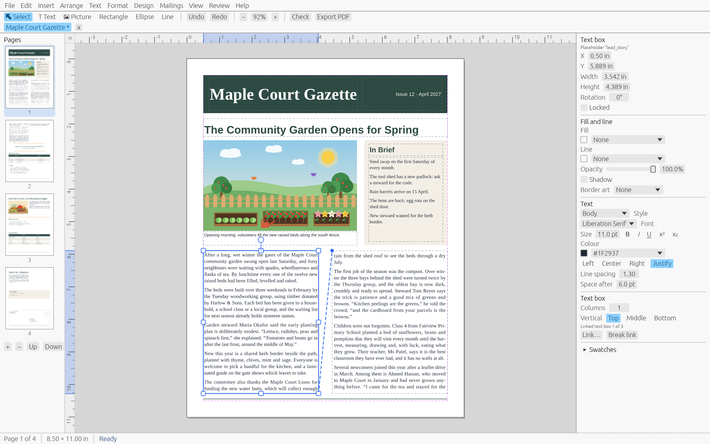

<p align="center"></p>

<h1 align="center">pubrs</h1>

<p align="center">A free, open-source desktop publisher for Windows, macOS and Linux.<br>
It opens Microsoft Publisher (.pub) files and exports print-shop PDF/X-4.</p>

<p align="center">
<a href="LICENSE"></a>
<a href="https://github.com/donaldsteele/pubrs/releases/latest"></a>
</p>



pubrs is a free alternative to Microsoft Publisher, which reached end of life in October 2026. Website: <https://donaldsteele.github.io/pubrs/>

## Download

Get the installer for your system from the [latest release](https://github.com/donaldsteele/pubrs/releases/latest).

| System | Installer |
|---|---|
| Windows 10/11 | MSI, x64 and ARM64 |
| macOS 12 or later | Universal DMG (Apple silicon and Intel) |
| Linux (X11 and Wayland) | `.deb` and AppImage, x86_64 and aarch64 |

**The installers are not signed.** Windows SmartScreen will say the publisher is unknown: choose *More info*, then *Run anyway*. On macOS, Control-click pubrs in Applications and choose *Open*. See [Installing](USER_GUIDE.md#installing) in the User Guide.

## What you get

- 13 built-in templates: flyer, trifold brochure, business card, newsletter, greeting card, postcard, certificate, menu, letterhead, envelope, calendar, address labels and a business card sheet.
- Tables, WordArt, drop shadows, BorderArt, and tight or through text wrap.
- Hyphenation, justification, drop caps, tab stops with leaders, bullets and numbering.
- Swatches (RGB, CMYK, spot), colour schemes, tints and gradients.
- PDF/X-4 export with bleed and crop marks, and "Save for a commercial printer".
- 26 Avery-style and A4 label and card sheet presets, and saddle-stitch booklets.
- Mail merge from CSV or XLSX to labels, letters, PDF or a new publication.
- A Design Checker, spell check, rulers and guides, and find and replace.
- Clipboard, input method (IME) and right-to-left text support.
- Import of Microsoft Publisher `.pub` files: text, pictures, shapes, tables and colour schemes from Publisher 2002 and later, text only from 98 and 2000. Some content, such as WMF drawings, goes into an import report instead.
- A command line (`pubrs`) and an MCP server (`pubrs-mcp`) so AI assistants can create and edit publications.
- An open, documented file format (`.pubrs`).

This is version 0.2. Expect rough edges.

## Documentation

- [User Guide](USER_GUIDE.md)
- [MCP server](MCP.md)
- [File format](FILE_FORMAT.md)
- [Architecture](ARCHITECTURE.md)

## Building from source

You need Rust 1.88 or later.

```
cargo build --release
cargo run -p pubrs-app
```

On Debian and Ubuntu, install these packages first (the list CI uses):

```
sudo apt-get install libxkbcommon-dev libxkbcommon-x11-0 libwayland-dev libx11-dev \
  libxcursor-dev libxrandr-dev libxi-dev libgl1-mesa-dev libfontconfig1-dev libdbus-1-dev
```

Run the tests with `cargo test --workspace`.

## Licence

[MIT](LICENSE).

Microsoft and Publisher are trademarks of Microsoft Corporation; pubrs is not affiliated with Microsoft. Avery and other product numbers are trademarks of their owners, used only to name label sheets.
